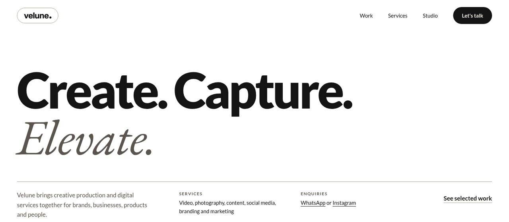

# Velune Creative Studio — website

[](https://github.com/shxamill/veluneproductions/actions/workflows/ci.yml) [](LICENSE) [](https://www.veluneproductions.com)



Static Astro site for Velune Creative Studio: home, selected work (6 project pages), services, studio, contact and 404.

## Run it

```bash
npm install
npm run dev        # http://localhost:4321 (live reload)
npm run build      # static output in dist/
npm run preview    # serve dist/ at http://localhost:4321
```

Node 22.23.4+ is required by Astro 7.4; Node 24 LTS is recommended and is what CI and Vercel use.

## Media

Original files in `brand_assets/` are never modified. `npm run media` (re-runnable; `FORCE=1` to rebuild) produces:

- `public/media/hero/`: showreel in AV1/WebM and H.264/MP4, 16:9 and 9:16, audio removed, first 0.8 s of flat grey trimmed.
- `public/media/work/<slug>/`: client videos as H.264 MP4 (HEVC `.MOV` files converted so they play in Chrome/Firefox).
- `src/assets/`: still images, hero posters and logo derivatives. Astro generates the responsive AVIF/WebP/JPEG sizes at build time.
- `public/favicon-32.png`, `public/apple-touch-icon.png`, `public/og.jpg`.

Requires `ffmpeg` (with libx264 and libsvtav1) and ImageMagick 7 (`magick`).

## Where things live

| What | Where |
|---|---|
| Verified brand facts, WhatsApp number, nav | `src/data/site.ts` |
| Nine services (brand book pp.9–15) | `src/data/services.ts` |
| Projects, media, alt text | `src/data/work.ts` |
| Design tokens and shared styles | `src/styles/global.css` |
| Hero video selection | `src/components/Hero.astro` |
| Enquiry form (WhatsApp hand-off) | `src/components/EnquiryForm.astro` |
| FAQ (answers from the brand book only) | `src/components/Faq.astro` |
| Research and design plan | `docs/website-research.md`, `docs/design-plan.md` |

## Enquiries

The form does not send anything by itself. It validates, composes a message and opens `wa.me/916235348787` with that message filled in, and the visitor presses send in WhatsApp. Without JavaScript, the form submits the project description to the same WhatsApp link.

## Visual QA

```bash
node scripts/screenshot.mjs http://localhost:4321/ --label=home            # 1440, 768, 390
node scripts/screenshot.mjs http://localhost:4321/ --reduced-motion --label=home-rm
```

Uses the installed Google Chrome over the DevTools Protocol (no npm dependencies). Screenshots go to `temporary screenshots/` and are never overwritten. The script also reports horizontal overflow, console errors, failed requests and which hero video file was fetched.

## Before launch

- Confirm a production domain, then set `site` in `astro.config.mjs` (this enables canonical URLs, absolute Open Graph URLs and the Organization `url`/`logo`) and add a sitemap/robots configuration.
- Confirm public-use permission for every client name and every photo and video shown (pages under `/work/` and the client list on `/studio/`).
- Confirm "Brand film" as the category label for Nomi Kids Culture.
- Supply a vector logo (the current one is derived from the 640 px JPEG) and, ideally, a dedicated favicon mark.
- Optional: a higher-resolution 16:9 showreel master (the current one is 1276×718).


## Repository maintenance

Contribution, security, and support expectations are documented in [CONTRIBUTING.md](CONTRIBUTING.md), [SECURITY.md](SECURITY.md), [CODE_OF_CONDUCT.md](CODE_OF_CONDUCT.md), and [SUPPORT.md](SUPPORT.md). Bug reports, feature requests, and pull requests use the templates under .github/.

The CI workflow runs the production build on pushes and pull requests. Dependabot checks npm dependencies weekly.

## Rights and licensing

No repository-level open-source license is currently provided. The site contains client names, project media, and Velune brand assets; verify public-use permission for each asset before publishing or redistributing it. Public repository visibility does not grant reuse rights.

## License and asset rights

All rights reserved. The code is public for portfolio viewing only and is not open source; see [LICENSE](LICENSE). The Velune name, logo and brand identity belong to Velune Creative Studio. Photographs, videos and other client work belong to Velune Creative Studio and/or the respective clients and may not be reused.
